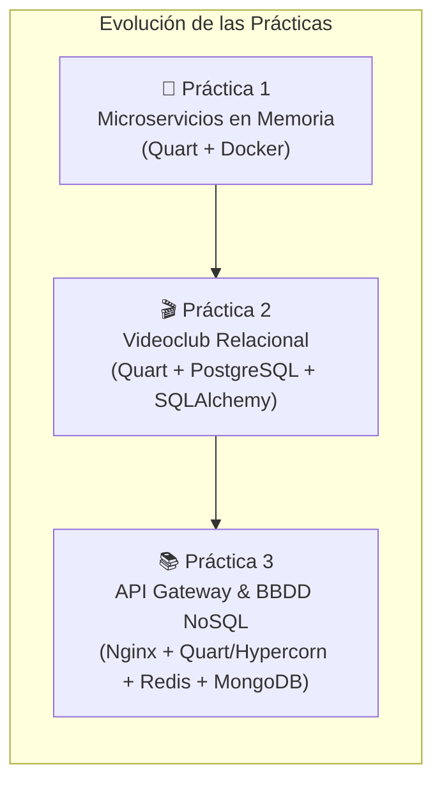

# 🖥️ Sistemas Informáticos — Prácticas (Curso 2026/2027)

**Escuela Politécnica Superior · Universidad Autónoma de Madrid (UAM)**  
**Autores:** Alejandro González García (`Alejandrog2006`) y Manuel Salvador Mayor (`tassburr-pixel`)

---

## 📌 Descripción General

Repositorio de prácticas de la asignatura **Sistemas Informáticos**, enfocado en el diseño, desarrollo y despliegue de arquitecturas distribuidas basadas en **microservicios API REST asíncronos (Quart)**, contenerización con **Docker Compose**, pasarelas de entrada (**API Gateway con Nginx**) y persistencia tanto relacional (**PostgreSQL**) como NoSQL (**Redis** y **MongoDB**).



---

## 🗂️ Estructura del Repositorio

```text
practicas-SI/
├── p1/                 # Práctica 1: Microservicios de Usuarios y Documentos (En memoria)
├── p2/                 # Práctica 2: Videoclub con PostgreSQL, Triggers y Optimización SQL
├── p3/                 # Práctica 3: Biblioteca con API Gateway (Nginx), Redis y MongoDB
└── README.md           # Documentación general del repositorio
```

---

## 🚀 Resumen de Prácticas

### 1️⃣ [Práctica 1 — Servicios de Usuarios y Documentos](./p1)
Introducción a la arquitectura de microservicios desacoplados con **Quart** y **Docker Compose**:
* **`user_service` (`:5050`):** Registro, autenticación de usuarios y actualización de credenciales.
* **`file_service` (`:5051`):** Gestión CRUD de ficheros por usuario y control de visibilidad pública/privada.
* **Autenticación:** Tokens firmados mediante secreto compartido (`SECRET_UUID`).
* **Persistencia:** Almacenamiento en memoria volátil.

```bash
cd p1
docker compose up --build -d
python3 cliente/cliente.py
```

---

### 2️⃣ [Práctica 2 — Videoclub con Persistencia Relacional (PostgreSQL)](./p2)
Sistema de comercio electrónico para un videoclub respaldado por **PostgreSQL** y **SQLAlchemy Core asíncrono**:
* **`user_service` (`:5050`):** Gestión de cuentas, recarga de saldo, baja lógica y sesiones *stateless* cifradas con **Fernet** (`TOKEN_SECRET` en `.env`).
* **`api_service` (`:5051`):** Catálogo de películas, carritos de compra, facturación transaccional, valoraciones e informes de ventas.
* **Base de Datos (`database/`):** Esquema relacional completo, funciones PL/pgSQL, triggers de integridad y optimización de consultas mediante índices y análisis `EXPLAIN`.

```bash
cd p2
cp .env.example .env
docker compose up --build -d
python3 client/client.py
```

---

### 3️⃣ [Práctica 3 — Microservicios Avanzados, API Gateway y BBDD NoSQL](./p3)
Arquitectura distribuida con punto de entrada único (**Nginx**) y persistencia políglota NoSQL (**Redis** + **MongoDB**) servida con **Hypercorn**:
* **`api-gateway` (`Nginx :8080`):** Proxy inverso y único puerto expuesto al exterior. Valida sesiones internamente mediante sub-peticiones `auth_request` (`/auth/validate`) e inyecta la identidad verificada en la cabecera `X-User-Id`.
* **`auth-service` (`Quart + Hypercorn :5050`):** Gestión de usuarios permanentes en **Redis** mediante estructuras `HASH` (`user:{username}`) con persistencia en disco (`--appendonly yes`) y sesiones temporales `session:{token}` con expiración automática (**TTL de 5 minutos**).
* **`library-service` (`Quart + Hypercorn :5051`):** Gestión de catálogo de libros e historial embebido de préstamos en **MongoDB** (`pymongo.AsyncMongoClient`), garantizando préstamos y devoluciones libres de condiciones de carrera mediante operaciones atómicas `find_one_and_update()`.

```bash
cd p3
docker compose up --build -d
pytest
```

---

## 🛠️ Tecnologías Utilizadas

| Categoría | Tecnologías |
| :--- | :--- |
| **Lenguaje y Backend** | Python 3.12 · Quart (ASGI) · Hypercorn |
| **API Gateway / Proxy** | Nginx (`ngx_http_auth_request_module`) |
| **Bases de Datos** | PostgreSQL 16 · Redis 7 (AOF + TTL) · MongoDB 7 |
| **Clientes y Drivers** | `SQLAlchemy[asyncio]` + `asyncpg` · `redis.asyncio` · `pymongo` (`AsyncMongoClient`) |
| **Testing y Contenedores** | Docker & Docker Compose · `pytest` · `httpx` · `anyio` |
