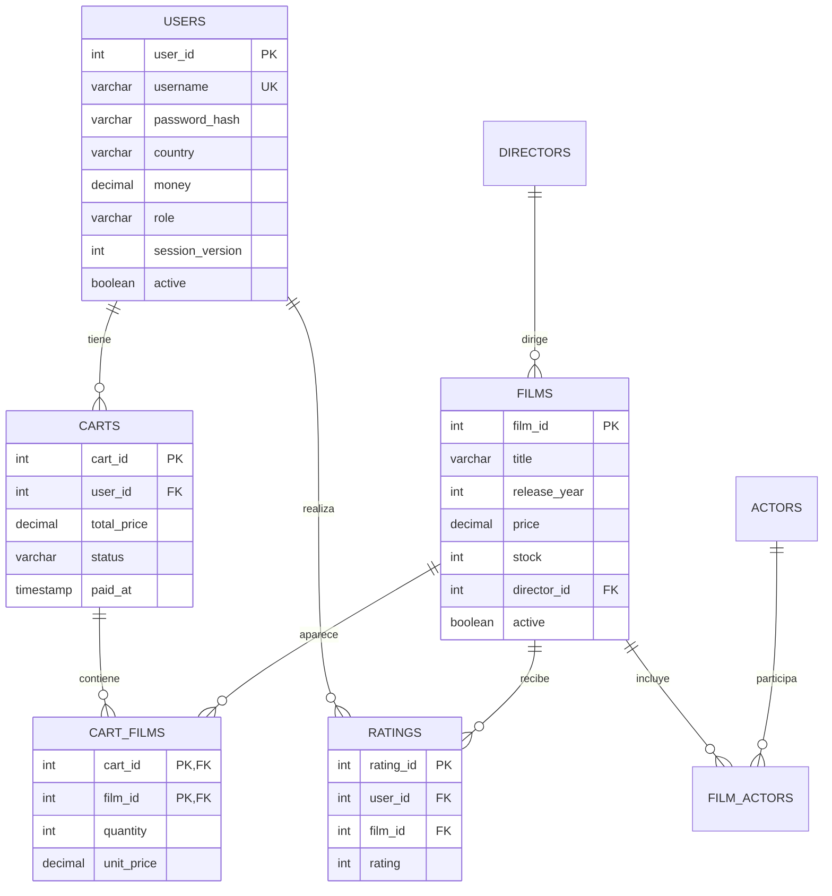

# Diseño de la Práctica 2

Este documento explica la estructura del videoclub implementado en `p2`. PostgreSQL es la única fuente de datos y se comparte entre los servicios `user_service` y `api_service`.

## Modelo de datos

### `users`

Almacena las cuentas de la plataforma:

- `user_id`: identificador interno.
- `username`: nombre único utilizado durante el login.
- `password_hash`: hash SHA-256 de la contraseña.
- `country`: país usado también por el informe de ventas.
- `money`: saldo disponible, siempre mayor o igual que cero.
- `role`: `user` o `admin`.
- `session_version`: número que invalida tokens anteriores al hacer login o logout.
- `active`: permite desactivar la cuenta conservando su historial.
- `created_at`: fecha de alta.

### `directors` y `actors`

Guardan los datos básicos de directores y actores. Una película puede tener un director y varios actores.

### `films`

Contiene el catálogo:

- `film_id`, `title` y `release_year` identifican la película.
- `price` es el precio actual.
- `stock` indica las unidades que todavía se pueden reservar.
- `director_id` referencia a `directors`.
- `active` permite retirar una película sin borrar ventas antiguas.

### `carts` y `cart_films`

`carts` representa un pedido con estado `open`, `paid` o `cancelled`. `paid_at` solo contiene una fecha cuando el carrito está pagado. El índice parcial `one_open_cart_per_user` limita a uno el número de carritos abiertos de cada usuario.

`cart_films` relaciona carritos y películas. Su clave primaria es `(cart_id, film_id)`, por lo que una película aparece una sola vez por carrito. `quantity` guarda las unidades y `unit_price` conserva el precio existente cuando se añadieron.

### `ratings`

Guarda un voto entre 0 y 10 por usuario y película. La restricción única `(user_id, film_id)` impide votos duplicados y permite actualizarlos con `ON CONFLICT`.

### `film_actors`

Resuelve la relación muchos a muchos entre películas y actores y almacena el personaje interpretado.

## Diagrama entidad-relación



## Automatización en PostgreSQL

- `manage_cart_film_stock()` reserva stock al añadir o aumentar unidades y lo devuelve al reducirlas o eliminarlas.
- `recalculate_cart_total()` recalcula el total después de cambiar una línea.
- `handle_cart_status_change()` descuenta el saldo y guarda `paid_at` al pagar.
- `get_or_create_open_cart()` devuelve el carrito abierto o crea uno.
- `add_film_to_cart()` incrementa una línea existente o crea una nueva.
- `remove_film_from_cart()` elimina una película del carrito.
- `pay_open_cart()` cambia el estado a `paid` y devuelve total y fecha.
- `cancel_open_cart()` devuelve el stock y cancela el carrito.
- `average_film_rating()` calcula la puntuación media.
- `sales_by_year_country()` genera el informe requerido por año y país.

Estas funciones permiten que cada endpoint complejo utilice un único `execute()` desde Python.

## Autenticación sin estado

El login incrementa `session_version` y genera un token Fernet cifrado cuyo
contenido interno es:

```text
user_id:session_version
```

El token cifrado se envía mediante:

```http
Authorization: Bearer <token>
```

Los tokens no se almacenan. Fernet cifra el contenido y autentica cualquier
modificación. Cada operación protegida descifra el token en Python y valida en
su única sentencia SQL que el usuario esté activo y que la versión coincida.
Login y logout incrementan la versión, por lo que los tokens anteriores dejan
de ser válidos.

## Endpoints

### Servicio de usuarios, puerto 5050

| Método | Ruta | Operación |
| --- | --- | --- |
| `PUT` | `/user` | Crear una cuenta |
| `POST` | `/user/login` | Iniciar sesión y emitir un token |
| `POST` | `/user/logout` | Invalidar el token actual |
| `PATCH` | `/user/recharge` | Recargar saldo |
| `DELETE` | `/user` | Desactivar la cuenta autenticada |

### API del videoclub, puerto 5051

| Método | Ruta | Operación |
| --- | --- | --- |
| `POST` | `/films` | Crear una película |
| `DELETE` | `/films/<film_id>` | Desactivar una película |
| `GET` | `/films` | Listar películas por criterios |
| `POST` | `/cart/films` | Añadir una película al carrito |
| `POST` | `/cart/pay` | Pagar el carrito abierto |
| `PUT` | `/films/<film_id>/rating` | Crear o modificar un voto |
| `GET` | `/films/<film_id>/rating` | Consultar la puntuación media |
| `GET` | `/ventas/<year>/<country>` | Consultar ventas por año y país |

## Consultas SQL desde Python

Los servicios escriben SQL manualmente con `text()` y separan los valores mediante parámetros:

```python
result = await session.execute(
    text("SELECT * FROM films WHERE release_year = :year"),
    {"year": year},
)
```

No se introducen valores mediante `f-string`. Cada operación combina autenticación y acción en una sola sentencia para respetar el límite de un único `execute()`.

## Estado de implementación

- El esquema, los datos iniciales y el servicio de usuarios están desarrollados.
- Los endpoints de `api.py` están implementados con consultas parametrizadas.
- `client.py` cubre casos correctos y errores esperados de ambos servicios.
- `optimizacion.sql` contiene los planes `EXPLAIN` antes y después, los índices
  y la función optimizada de ventas.
