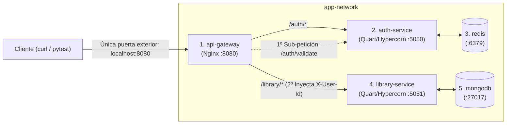
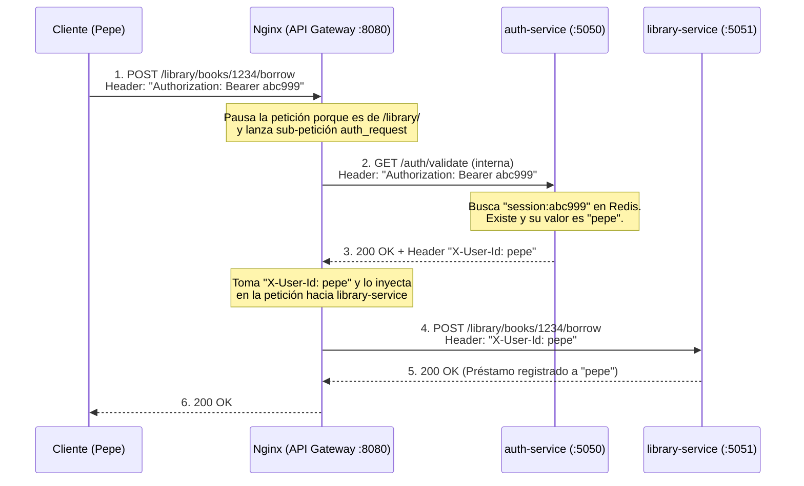
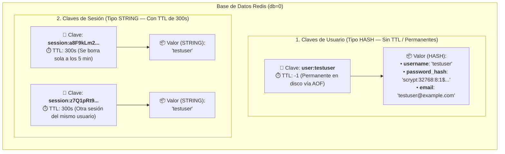

# 📘 Guía Explicativa y Apuntes de Arquitectura — Práctica 3

Este documento recoge de forma didáctica cómo funciona toda la arquitectura de la **Práctica 3**, qué hace cada tecnología, cómo se comunican los contenedores y cómo es el esquema interno de las bases de datos NoSQL (**Redis** y **MongoDB**). Además, sirve como base directa para redactar la **Memoria** de la práctica.

---

## 1. Mapa General: ¿Qué son los 5 contenedores y cómo se conectan?

En lugar de tener un único programa monolítico, el sistema se divide en **5 contenedores independientes** dentro de una misma red privada de Docker (`app-network`):

### ¿Qué es cada tecnología?
1. **API REST:** Forma de comunicación entre programas mediante rutas URL (`/auth/login`, `/library/books`), verbos HTTP (`GET`, `POST`, `DELETE`) y respuestas en formato de texto **JSON** (sin páginas HTML ni interfaz gráfica).
2. **Nginx (`api-gateway`):** Es un **Proxy Inverso** (un programa ya hecho que actúa como recepcionista/guardia en la puerta). Es el **único contenedor que da al exterior (`localhost:8080`)**. Recibe todas las llamadas y decide a qué microservicio interno enviárselas.
3. **Quart:** Framework web en Python (idéntico a Flask, pero **asíncrono** con `async def` y `await`) donde programamos nuestros endpoints.
4. **Hypercorn:** Servidor de aplicaciones ASGI. Quart son solo las funciones de Python (el "cerebro"), mientras que **Hypercorn** es el "motor" que escucha en el puerto de red (`5050` o `5051`) y ejecuta la aplicación Quart.
5. **Redis:** Base de datos NoSQL en memoria RAM de tipo **Clave-Valor** con persistencia en disco (`--appendonly yes`). La utiliza `auth-service` para guardar usuarios y sesiones con caducidad automática (TTL).
6. **MongoDB:** Base de datos NoSQL orientada a **documentos JSON**. La utiliza `library-service` para guardar los libros y sus historiales de préstamos.

---

## 2. Puertos en Docker y el formato `0.0.0.0:5050`

### ¿Qué es un puerto (`8080`, `5050`, `5051`)?
* Si la **IP** (o nombre del contenedor) es la dirección del edificio, el **Puerto** es el **número de puerta o ventanilla** (del 1 al 65535) donde un programa concreto espera mensajes:
  * **Nginx:** Ventanilla `8080`.
  * **`auth-service`:** Ventanilla `5050`.
  * **`library-service`:** Ventanilla `5051`.
  * **Redis:** Ventanilla `6379`.
  * **MongoDB:** Ventanilla `27017`.

### ¿Hay que poner `ports:` en todos los contenedores del `docker-compose.yml`?
**NO.**
* Dentro de la red `app-network`, los 5 contenedores **ya se ven entre sí automáticamente** sin usar `ports:`.
* **`ports: - "8080:8080"`** abre un túnel desde tu **ordenador real (exterior)** hacia el contenedor. Solo lo lleva `api-gateway` (Nginx) porque el enunciado exige que nadie desde fuera pueda atacar directamente a `auth-service`, `library-service`, `redis` ni `mongodb`.
* **`expose: - "5050"`** solo documenta que el contenedor usa ese puerto dentro de la red interna de Docker, pero **no lo abre al exterior**.

### ¿Qué significa `CMD ["hypercorn", "app:app", "--bind", "0.0.0.0:5050", "--reload"]`?
* **`hypercorn`**: Arranca el servidor ASGI.
* **`app:app`**: Busca el paquete/carpeta `app/` (`__init__.py`) y dentro de él la variable `app = create_app()`.
* **`--bind 0.0.0.0:5050`**:
  * Si pusiéramos `127.0.0.1:5050`, el servidor solo aceptaría conexiones nacidas dentro de su propio contenedor y rechazaría las llamadas de Nginx.
  * **`0.0.0.0`** significa *"escucha en todas las tarjetas de red del contenedor"*, permitiendo que Nginx se conecte a él por la red de Docker.
* **`--reload`**: Recarga el servidor automáticamente si detecta cambios en el código.

---

## 3. Cómo funciona Nginx (`auth_request` y la cabecera `X-User-Id`)

Cuando un usuario quiere hacer cualquier operación en la biblioteca (por ejemplo, `POST /library/books/1234/borrow`), `library-service` no sabe nada de tokens ni tiene conexión con Redis. Todo el control lo coordina **Nginx**:

* Si en el paso 3 el token no existe o ha caducado, `auth-service` responde **`401 Unauthorized`** y Nginx corta inmediatamente la petición devolviendo `401` al cliente, sin llegar a tocar `library-service`.
* Si un cliente malintencionado intenta enviar desde fuera una cabecera falsa `X-User-Id: admin`, Nginx la pisa y la sustituye por el `$user_id` real devuelto por `/auth/validate`.

---

## 4. ¿Por qué en P3 NO hace falta un `TOKEN_SECRET` en `.env` como en P1 y P2?

* **En P1 y P2 (Tokens *Stateless*):** El token llevaba los datos del usuario cifrados dentro (con Fernet), porque la base de datos no guardaba sesiones. Por eso hacía falta una clave secreta (`TOKEN_SECRET`) para cifrar y descifrar el sobre.
* **En P3 (Tokens *Stateful* en Redis):** El token es un código aleatorio (`secrets.token_urlsafe(32)`) que funciona como el **ticket de un guardarropa**. Al hacer login se guarda en Redis (`session:<token> -> username`). Para validarlo no hay que descifrar nada: basta con mirar si esa clave existe dentro de Redis.

---

## 5. Esquema de Datos de Redis (`auth-service`)

En Redis no existen tablas ni columnas SQL. Todo convive en un gran espacio de claves organizado mediante **prefijos con dos puntos (`:`)**:

### Resumen de las 2 estructuras en Redis

| Característica | 1. Perfil de Usuario (`user:{username}`) | 2. Sesión Temporal (`session:{token}`) |
| :--- | :--- | :--- |
| **Tipo en Redis** | **`HASH`** (diccionario con `username`, `password_hash`, `email`) | **`STRING`** (contiene el `username` propietario del token) |
| **Creación en Python** | `await r.hset(f"user:{username}", mapping={...})` | `await r.set(f"session:{token}", username, ex=300)` |
| **Lectura en Python** | `await r.hgetall(f"user:{username}")` | `await r.get(f"session:{token}")` |
| **Borrado en Python** | No se borra | `await r.delete(f"session:{token}")` (en `/auth/logout`) |
| **Caducidad (TTL)** | **Sin TTL** (permanente). Se guarda en disco con `--appendonly yes` (AOF). | **TTL = 300 segundos (5 minutos)**. Al llegar a 0, Redis la elimina sola. |

### Resumen de los 4 Endpoints de `auth-service`

| Endpoint | Método | ¿Qué hace en Redis? | Códigos de respuesta |
| :--- | :--- | :--- | :--- |
| `/auth/register` | `POST` | Comprueba `exists("user:{username}")` y crea el `HASH` con `hset` y contraseña cifrada. | `201` (creado), `409` (ya existe), `400` (datos inválidos) |
| `/auth/login` | `POST` | Lee el `HASH` con `hgetall`, verifica el hash de la contraseña y crea `session:{token}` con `ex=300`. | `200` (devuelve `{"token": ...}`), `401` (credenciales malas) |
| `/auth/validate` | `GET` | Busca `get("session:{token}")`. Llamado internamente por Nginx. | `200` + cabecera `X-User-Id: <username>`, o `401` |
| `/auth/logout` | `POST` | Ejecuta `delete("session:{token}")` para invalidar el token al instante. | `200` (si borró 1 clave), `401` (si borró 0 claves o falta token) |
